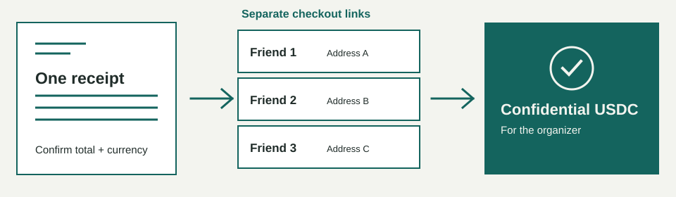

# split/d/bill

Split a shared receipt into individual USDC reimbursement requests. Built for friends meeting across borders who use different currencies and want to keep the organizer's personal wallet out of the group chat.

[Open split/d/bill](https://split-d-bill.vercel.app)

## How it works

1. Upload a receipt or enter a bill manually → confirm its total and currency. Optional receipt reading can suggest details when configured; review and confirm every suggestion. Otherwise enter them manually.
2. Enter the organizer's Confidential Intents receiving address → review equal USDC shares, excluding the organizer's own share.
3. Share each private checkout link → each payer sees their own request and the organizer sees repayment progress. Solana and Zcash quotes use separate deposit addresses for each payer; the app rejects a duplicate before displaying it.

The public app can create real payment requests for **Zcash from VIZOR or Zodl** and **Solana USDC**, routed through NEAR Intents toward the organizer's confidential USDC balance. Wallet compatibility and refunds still need broader verification. Sending from an existing NEAR Confidential Intents balance is not enabled.

## Privacy

Each payer receives a separate private checkout link; anyone with a link can access its associated request, so share it carefully. The organizer recovery link grants access to the bill and should also be kept private.

Privacy depends on the payment route. A shielded Zcash source does not make every part of a payment private: deposit details can be public and routing providers process payment data. Ordinary Solana USDC transfers expose the sender and amount on-chain. The app does not promise universal anonymity or unlinkability. See [privacy details](docs/technical/PRIVACY.md).

## NEAR Hackathon tracks

- **Real-World Money**: stablecoin reimbursements for shared real-world expenses.
- **Privacy & Private AI**: shielded-source Zcash and confidential receiving, with route-specific privacy limits; optional receipt reading sends the image to a configured provider with your consent; provider privacy terms apply.
- **Social Money**: separate payer links and shared reimbursement progress for a group.

## Build provenance

The application was built during the November 2026 NEAR HACKATHON. The [initial workspace commit](https://github.com/youngjei/near-hackathon-2026/commit/9a1d14f) contains preparation research; [the subsequent diff](https://github.com/youngjei/near-hackathon-2026/compare/9a1d14f...main) shows the application work. No existing Split/d/bill app or external app template was reused. The project uses React, Next.js, Vinext, Supabase, Drizzle, NEAR Connect and the NEAR Intents SDK; Codex assisted with research and implementation.

Project code and documentation are available under the [MIT License](LICENSE). The bundled Space Grotesk font retains its own Open Font License.

[Developer setup](app-web/README.md) · [Architecture](docs/technical/ARCHITECTURE.md)
